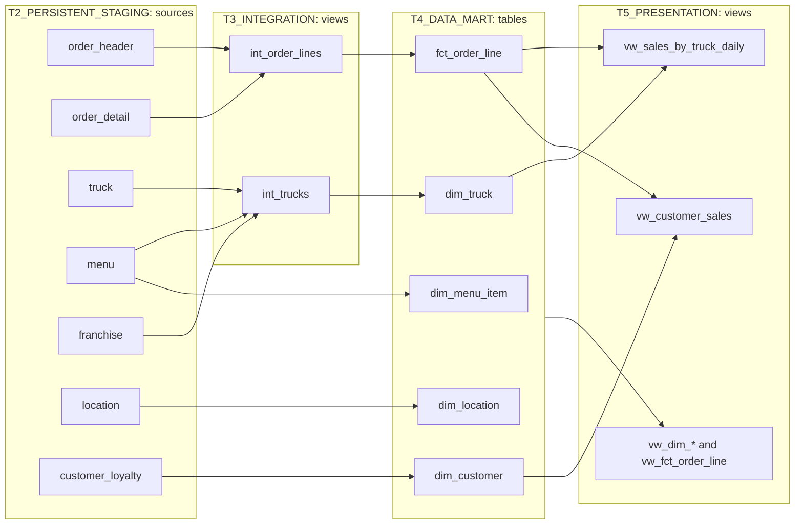

# Walkthrough: the Tasty Bytes example

This document walks through a small, working example built with the EDW dbt project. It loads Tasty Bytes point-of-sale data (a fictional food-truck company from Snowflake's quickstarts) into the persistent staging tier, then builds an interim layer, a star schema and presentation views on top. Everything builds into the right database and schema for each of the four environments (DEV, TEST, UAT, PROD), both from a laptop and from the dbt project object deployed in Snowflake.

The goal is to show how the project is structured and how dbt works, not to model Tasty Bytes well. The models are deliberately small.

[README.md](README.md) is the reference for the project's configuration; this document is the guided tour.

## 1. The shape of it



| Tier | Objects | Materialization | Role |
|---|---|---|---|
| T2 | 8 raw tables | loaded outside dbt | dbt reads them as sources |
| T3 | `int_order_lines`, `int_trucks` | view | interim processing: joins, deduplication, type fixes, the date window |
| T4 | 4 dims, `fct_order_line` | table | the star schema; tested and persisted |
| T5 | `vw_dim_*`, `vw_fct_order_line`, 2 aggregates | view | what consumers query |

Each environment ends up with 14 objects, all in a `TASTY_BYTES` schema in each tier database (`DEVONB_TASTY_BYTES` in DEV).

## 2. Loading the raw data

The data came from an earlier quickstart in `TASTY_BYTES_DBT_DB.DEV`. [setup/clone_tasty_bytes.sql](setup/clone_tasty_bytes.sql) zero-copy clones its 8 base tables into `<ENV>_T2_PERSISTENT_STAGING.TASTY_BYTES` for all four environments, then gives ownership to SYSADMIN, the role dbt runs as.

- **Why clones.** A clone shares storage with its source until either side changes, so four copies of ~900M rows cost nothing to create or store. Each environment still has its own independent tables, as it would in real life.
- **Why tables, not the quickstart's `RAW_*` views.** Those were `SELECT *` views over the same base tables, and Snowflake can't clone a view on its own.
- **Why outside dbt.** In the EDW, T1 and T2 are loaded by ingestion tools, not by dbt. The clone script stands in for that ingestion.

## 3. Sources: how dbt reads T2

dbt calls data it doesn't build a **source**. Sources are declared in [models/sources/_sources.yml](models/sources/_sources.yml):

```yaml
sources:
  - name: tasty_bytes
    database: "{{ target.name | upper }}_T2_PERSISTENT_STAGING"
    schema: TASTY_BYTES
    tables:
      - name: order_header
      ...
```

A model then writes `{{ source('tasty_bytes', 'order_header') }}` instead of a table name. dbt replaces it at compile time with the full name for the current target: `DEV_T2_PERSISTENT_STAGING.TASTY_BYTES.order_header` under `--target dev`, `PROD_...` under `--target prod`. The `{{ }}` is Jinja, the template language dbt runs over every SQL and YAML file before sending anything to Snowflake.

Two things to note:
- The naming macros (section 5) don't apply to sources, so the environment prefix is spelled out from `target.name` here.
- Sources get no DEV prefix. All developers read the same `DEV_T2` tables; only what dbt *builds* is per developer.

`source()` also records lineage: dbt knows `int_order_lines` depends on `order_header`, which is what makes `dbt build --select +fct_order_line` (the fact and everything upstream of it) work.

## 4. The models

Each model is one `SELECT` in a `.sql` file. dbt wraps it in the DDL for its materialization (`CREATE OR REPLACE VIEW ... AS`, `CREATE OR REPLACE TABLE ... AS`), so models never contain DDL. The file name is the object name.

Models refer to each other with `{{ ref('model_name') }}`. Like `source()`, it compiles to the full name for the target and records the dependency, and dbt uses those dependencies to build models in the right order.

### T3: interim processing

- [int_order_lines](models/T3_INTEGRATION/TASTY_BYTES/int_order_lines.sql) joins each order line to its header, keeps only orders on or after the date window, and fixes types (`LOCATION_ID` is a FLOAT in the raw data).
- [int_trucks](models/T3_INTEGRATION/TASTY_BYTES/int_trucks.sql) joins truck to brand (from MENU) and franchisee (from FRANCHISE). Both lookups are first reduced to one row per key, so the join can't duplicate trucks (see section 6 for how we found that out).

These are views: cheap to build and always current. Nothing reads them except T4.

### T4: the star schema

- **Dimensions:** [dim_truck](models/T4_DATA_MART/TASTY_BYTES/dim_truck.sql) just publishes `int_trucks`. [dim_location](models/T4_DATA_MART/TASTY_BYTES/dim_location.sql) and [dim_menu_item](models/T4_DATA_MART/TASTY_BYTES/dim_menu_item.sql) read their sources directly, because there is nothing to clean. A T3 model is only worth adding when it does real work. [dim_customer](models/T4_DATA_MART/TASTY_BYTES/dim_customer.sql) adds a `-1` "Unknown" row for orders without a loyalty account.
- **Fact:** [fct_order_line](models/T4_DATA_MART/TASTY_BYTES/fct_order_line.sql), one row per order line: keys to each dimension plus quantity, unit price and line amount. A NULL customer becomes `-1`, so every fact row joins to `dim_customer` and the fact can be tested for orphans.

These are tables, so consumers don't pay for the joins on every query.

### T5: presentation

- `vw_dim_truck`, `vw_dim_location`, `vw_dim_menu_item`, `vw_dim_customer`, `vw_fct_order_line`: `select * from {{ ref(...) }}` pass-throughs. Consumers (and their grants) see only T5, so T4 can be restructured without breaking them.
- [vw_sales_by_truck_daily](models/T5_PRESENTATION/TASTY_BYTES/vw_sales_by_truck_daily.sql) and [vw_customer_sales](models/T5_PRESENTATION/TASTY_BYTES/vw_customer_sales.sql): aggregates over the star.

A `select *` view's column list is fixed when Snowflake creates it. That doesn't matter here, because dbt recreates every view on every build.

### Compared with the quickstart

The quickstart put everything in one layer: `orders` was a single wide table joining six raw tables, and `customer_loyalty_metrics` aggregated straight from raw order headers. Here the same logic is split by purpose: joins and cleanup in T3, attributes in dims, keys and measures in the fact, aggregates in T5. `vw_customer_sales` is the quickstart's `customer_loyalty_metrics` rebuilt over the star.

### Materializations come from the folder

No model sets its own materialization. [dbt_project.yml](dbt_project.yml) sets one per tier folder, and every model in that folder inherits it:

```yaml
models:
  edw:
    T4_DATA_MART:
      +database: T4_DATA_MART
      +materialized: table
```

A schema folder or a single model can override it (`{{ config(materialized='incremental') }}` at the top of a model).

### The date window: a project variable

The order tables hold ~250M headers and ~670M lines (2019 to 2022-11-01). To keep test builds quick and cheap, `int_order_lines` filters on a **var**, a project-level parameter defined in `dbt_project.yml`:

```yaml
vars:
  tasty_bytes_order_start_date: "2022-10-01"
```

```sql
where order_ts >= '{{ var("tasty_bytes_order_start_date") }}'
```

The default is one month (~38M order lines). Override it for a single run: `dbt build --vars '{tasty_bytes_order_start_date: "2022-01-01"}'`.

## 5. Where objects land: the naming macros

dbt decides each object's database and schema by calling two macros, which this project overrides:

- [generate_database_name](macros/generate_database_name.sql): `<TARGET>_<TIER>`, from the target name and the tier folder's `+database`.
- [generate_schema_name](macros/generate_schema_name.sql): the schema folder name, prefixed under `dev` with `DBT_DEV_PREFIX`.

So `models/T4_DATA_MART/TASTY_BYTES/fct_order_line.sql` builds to:

| Target | Object |
|---|---|
| `dev` | `DEV_T4_DATA_MART.DEVONB_TASTY_BYTES.FCT_ORDER_LINE` |
| `test` | `TEST_T4_DATA_MART.TASTY_BYTES.FCT_ORDER_LINE` |
| `uat` | `UAT_T4_DATA_MART.TASTY_BYTES.FCT_ORDER_LINE` |
| `prod` | `PROD_T4_DATA_MART.TASTY_BYTES.FCT_ORDER_LINE` |

Because `ref()` goes through the same macros, `vw_fct_order_line` in DEV reads *your* `DEVONB_TASTY_BYTES.FCT_ORDER_LINE`, not someone else's. That is also why, in DEV, you build a model's upstream models too (`--select +model`).

To see the names without building anything, run `dbt compile --target prod` and open `target/compiled/edw/models/...`.

## 6. Tests

dbt tests are queries that return the rows that break a rule; a test passes when it returns nothing. The project has 30.

**Generic tests** are declared in YAML next to the models (`_tasty_bytes__models.yml` in each tier folder) and in `_sources.yml`:

| Test | Example | Checks |
|---|---|---|
| `unique`, `not_null` | `fct_order_line.order_detail_id` | the grain of every dim and the fact |
| `relationships` | `fct_order_line.truck_id` to `dim_truck.truck_id` | no orphan keys in the fact |
| `accepted_values` | `dim_menu_item.item_category` | only Main, Beverage, Dessert, Snack |
| source tests | `truck.truck_id` unique | the raw data, before any model reads it |

**Singular tests** are standalone SELECTs in `tests/`, for rules the generic tests can't express. [assert_order_line_amount_is_quantity_times_price](tests/assert_order_line_amount_is_quantity_times_price.sql) checks every line amount equals quantity times unit price.

`dbt build` runs models and tests together in dependency order. When a test fails, dbt skips every model downstream of it, so bad data doesn't spread into the marts.

### What the tests caught

The first build failed: the source test `unique` on `franchise.franchise_id` found 10 duplicated ids. Some franchisees have one row per city they operate in; others are exact duplicates. dbt skipped `dim_truck`, `vw_dim_truck` and `vw_sales_by_truck_daily`, which would otherwise have contained duplicated trucks.

The fix was in two parts:
1. `int_trucks` reduces FRANCHISE to one row per id before joining.
2. That source test was set to `severity: warn`. The build still reports the known issue every run but no longer stops. The uniqueness that matters is tested on `dim_truck.truck_id`.

That is the usual pattern: test sources to find problems, fix them in T3, test the result in T4.

Tests can cost real compute, so the big order tables have no source tests (a `unique` on 670M rows costs more than the whole build). Their keys are tested on the fact, after the date window.

## 7. Running it

### Locally

```bash
cd dbt
export DBT_DEV_PREFIX=DEVONB
dbt build --target dev                                   # everything, with tests
dbt build --target dev --select +vw_sales_by_truck_daily # one view and its upstream
dbt compile --target prod                                # names only, no build
```

### In Snowflake (the deployed project object)

The same files are deployed to `DEV_T3_INTEGRATION.DBT.EDW` (see the README for the deploy steps) and run with:

```sql
EXECUTE DBT PROJECT DEV_T3_INTEGRATION.DBT.EDW ARGS = 'build --target test' ENVIRONMENT = 'test';
```

Hosted runs get no shell, so `env.yml` supplies `DBT_DEV_PREFIX` for DEV from the caller's Snowflake user. The run's output appears in the result's `STDOUT` column.

Two gotchas from this test:
- dbt doesn't drop objects for models you delete. Removing the HCM smoke-test models meant dropping their schemas by hand.
- `snow stage copy --overwrite` doesn't delete stage files either, so the deleted models were still on the stage. Clear the stage folder before each deploy.

## 8. What was verified

For each of `dev`, `test`, `uat` and `prod`, both locally and as a hosted run:
- `dbt compile` and `dbt build` succeed: 14 models, 30 tests, 43 pass, 1 expected warning (the franchise duplicates).
- Each tier database holds exactly the expected objects: 2 views in T3, 5 tables in T4, 7 views in T5, in `DEVONB_TASTY_BYTES` for DEV and `TASTY_BYTES` elsewhere, with nothing in any other schema.
- `fct_order_line` has 38,351,186 rows, matching the windowed source count, and `dim_truck` has 450, matching TRUCK.
- With `DBT_DEV_PREFIX` unset, `dbt compile --target dev` fails with a message saying how to set it.

## 9. Demo script

A run-through for showing colleagues, about 20 minutes:

1. **Layout.** Open `models/` and show tier folder, schema folder, model file. Run `dbt compile --target dev` and `--target prod`, then compare the same compiled file: the names change, the SQL doesn't.
2. **Sources and ref.** Open `int_order_lines.sql` and its compiled version side by side.
3. **Lineage.** Run `dbt ls --select +vw_customer_sales --resource-type model`, which lists the models upstream of the view (drop `--resource-type` to see their tests too).
4. **Build.** Run `dbt build --target dev --select +vw_sales_by_truck_daily`. Show the order: source tests, T3, T4 plus their tests, T5.
5. **A failing test.** Set the franchise test back to `severity: error` and rebuild. Show the failure and the skipped downstream models, then restore it.
6. **Hosted.** Run the same build with `EXECUTE DBT PROJECT ... --target test` in Snowsight, then query `TEST_T5_PRESENTATION.TASTY_BYTES.VW_SALES_BY_TRUCK_DAILY`.

## 10. Deliberately left out

These would be the next things to learn, and each is a small change to this example:
- **Incremental models** for `fct_order_line`, to load only new orders instead of rebuilding.
- **Snapshots** (dbt's SCD Type 2) for slowly changing dims such as `dim_customer`.
- **Packages** such as `dbt_utils`, for tests like unique-combination-of-columns. Hosted runs need an external access integration to download packages.
- **Docs:** `dbt docs generate` builds a browsable site from the descriptions in the YAML files.
- **`--defer`**, so a DEV build can read unchanged upstream models from TEST or PROD instead of building them.
